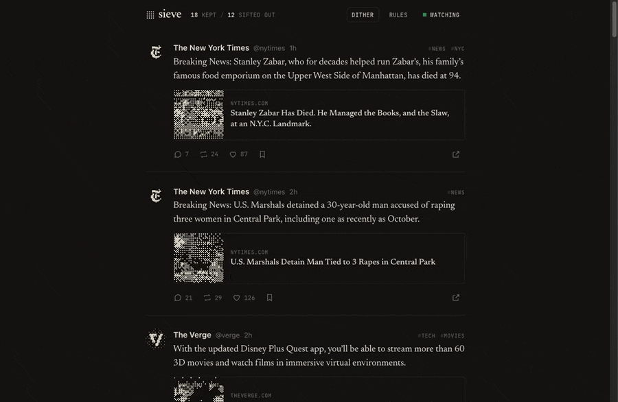

# Sieve

**Turn social media into your personal media.**



<sub>Demo with public accounts (NASA, NatGeo, The Verge, NYT, Anthropic, OpenAI) and the rule “hide anything about AI”. [MP4](docs/demo.mp4)</sub>

Your coding agent scrolls your feeds for you (X, Reddit and more), in your own signed-in browser, using browser use. It reads every post, keeps only what your rules allow ("nothing about AI", "no engagement bait"), and puts the rest in **one** feed at `localhost:4545`, in a UI you design.

It works the other way too. When you like, upvote, repost, comment or save in your feed, the agent does it on the real site for you, so each site's algorithm learns what you actually want. You never open those sites again.

```
 you ──▶ localhost:4545 (your UI) ──clicks──▶ Sieve server ──▶ your agent ──browser use──▶ X, Reddit, …
     ◀── posts you'd actually want  ◀──────── filtered by your rules ◀─────── reads every post
```

## Sources

| Source | Reads | Actions it does for you | Status |
|---|---|---|---|
| **X** | your home timeline, any profile | like, repost, quote, reply, bookmark | live: reads verified; likes done on real X from Sieve clicks |
| **Reddit** | your home feed (Best), any subreddit, via Reddit's own JSON in your session | upvote, comment, save | live: reads verified (72 posts); buttons found and state read signed in |
| **YouTube** | your home page or subscriptions (`--url …/feed/subscriptions`); ads flagged, Shorts and auto-Mixes skipped | like, comment, watch later | live: reads verified (72 videos); like, Watch later and comment box found signed in; the video is paused and muted before any action |
| **Bluesky** | your Following timeline (Bluesky's own API, with the page's session), or the public Discover feed when signed out | like, repost, quote, reply, save | reads verified signed out (119 posts from Discover); all buttons found on a real post; acting needs you signed in, and Sieve locks the buttons until then |
| **LinkedIn** | your home feed, through LinkedIn's own feed API with the page's session (the 2026 web feed hides post ids in the page) | like, comment, repost, save | live: reads verified (56 posts: images, articles, documents, network context, 14 ads flagged); like, repost, Save and the comment editor found signed in. LinkedIn restricts accounts that automate, so Sieve acts only on your clicks and stops at the first warning |

Turn sources on and off in the **Sources** panel. Each one is a folder in `sources/<id>/`: `source.json` (what it is and what it can do), `read.js` (runs in the page) and `act.js` (does an action, then checks the site's state). Adding a site means adding a folder.

## Quick start

```bash
git clone https://github.com/VedSoni-dev/sieve && cd sieve
npm start                      # http://localhost:4545  (no dependencies)
```

Then, in the same folder, tell your coding agent:

> Use the sieve skill: scroll my feeds

Sign in to each site once in the browser your agent uses. The agent never types your password.

## Your rules

Click **Rules** in the UI, or edit `data/rules.md`. Plain words:

```md
## Hide
- Anything about AI, even if it doesn't say "AI"
- Engagement bait, giveaways, ads
## Keep
- Space, nature, photography, sports
```

The agent re-reads them every round and uses judgement, not keyword matching. Everything it hides shows up under **hidden** with a reason, so you can check its work.

## Make the UI yours

The template ships as paper and ink. Every photo and avatar is an ordered (Bayer 8×8) dither in two inks (`ui/dither.js`); hover a photo to develop the real one, or turn **Dither** off. Keys: `j`/`k` move, `l` like, `b` bookmark, `r` reply, `o` open on X.

`ui/` is a template. Ask your agent "change my Sieve UI to a three-column magazine", "only show images", "add a reading-time badge", or edit `ui/index.html`, `ui/style.css` and `ui/app.js` yourself. Posts come from `GET /api/feed` and update live on `/api/events`.

## Browser use

| Your agent has | How Sieve uses it |
|---|---|
| **Aside** | `node bin/aside.js read reddit 3`, `node bin/aside.js act reddit like <url>`, `node bin/aside.js probe x <url>` (finds buttons and state, never clicks) |
| Claude in Chrome, Playwright MCP, anything that runs JS | evaluates `sources/<id>/read.js` in the page; actions follow `sources/<id>/act.js` |
| screenshot-only computer use | follows `sources/<id>/act.js` by sight |

Claude Code reads `.claude/skills/sieve/SKILL.md`; Codex, Gemini CLI and Cursor read `AGENTS.md`, `GEMINI.md` and `.cursor/rules/sieve.mdc`, which point to the same skill.

## How the agent behaves

- It only does what you clicked. It never likes, follows, posts or DMs on its own initiative.
- Quote and reply text goes out exactly as you wrote it.
- It works at a human pace, about 2 seconds between actions. On a rate limit, captcha or login wall it stops and tells you.
- It waits on `node bin/sieve.js wait`, a long-poll that returns the moment you click, so actions happen within seconds without burning tokens.

## API (for your agent or your own scripts)

| | |
|---|---|
| `POST /api/feed` | `{posts:[…], hidden:[{id, handle, text, reason}]}` |
| `GET /api/feed` | posts, newest first (time comes from X's Snowflake ids) |
| `POST /api/actions` | `{type: like / unlike / repost / unrepost / quote / reply / bookmark / unbookmark / more, postId, text?}` |
| `GET /api/actions/wait?timeout=55` | blocks until there's something to do |
| `POST /api/actions/:id` | `{status: working / done / failed, error?}` |
| `GET/PUT /api/rules`, `POST /api/agent`, `GET /api/events` | rules, heartbeat, live stream |
| `GET /img?u=` | same-origin proxy for `pbs.twimg.com` images (so the canvas can dither them); nothing else |

The server only listens on 127.0.0.1 and refuses requests from other websites.

## Honest notes

- Automating your own account may break X's terms. Sieve acts only on your clicks, at human pace, on your machine.
- Sites change their markup, and X serves different versions to different sessions. The readers and action steps match by meaning (test-ids, labels, structure, or the site's own JSON), not position, and `aside.js probe` shows quickly when one breaks; your agent can fix it.
- Not affiliated with X.

MIT
